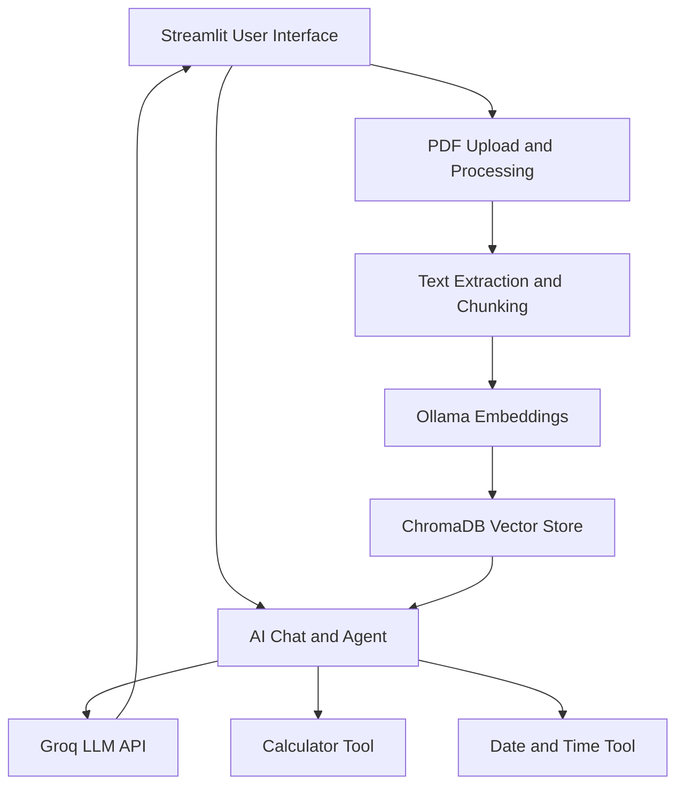

# NexaAI Studio 🤖

**An all-in-one Generative AI application combining chat, document intelligence, and AI agents.**

NexaAI Studio is a Python-based application that combines an AI chatbot, Retrieval-Augmented Generation (RAG), and tool calling in one interface. Users can chat with an AI assistant, upload PDFs and ask questions about their content, and perform tasks using AI-selected tools.

## ✨ Features

- AI-powered conversational interface
- PDF upload and text extraction
- Document question answering using RAG
- Text embeddings generated with Ollama
- Vector storage and retrieval with ChromaDB
- AI tool calling for calculations
- Current date and time lookup
- Agent action logs
- Interactive Streamlit interface

## 🛠️ Technology Stack

- Python
- Streamlit
- Groq API
- Ollama
- ChromaDB
- PyPDF
- Retrieval-Augmented Generation (RAG)
- AI function calling

## ⚙️ Prerequisites

- Python 3.13 or a compatible version
- Ollama installed and running
- The `nomic-embed-text` embedding model
- A Groq API key

## 🚀 Local Installation

1. Clone this repository:

   ```bash
   git clone YOUR_GITHUB_REPOSITORY_URL
   cd NexaAI-Studio
   ```

2. Create and activate a virtual environment:

   ```powershell
   python -m venv .venv
   .\.venv\Scripts\Activate.ps1
   ```

3. Install dependencies:

   ```bash
   python -m pip install -r requirements.txt
   ```

4. Download the embedding model:

   ```bash
   ollama pull nomic-embed-text
   ```

5. Create `.streamlit/secrets.toml` and add your Groq API key:

   ```toml
   GROQ_API_KEY = "your_groq_api_key_here"
   ```

6. Start the application:

   ```bash
   python -m streamlit run app.py
   ```

7. Open the local URL shown in your terminal. Upload a PDF, process it, and ask questions about its content.

## 🔐 Security

Never commit API keys or `.streamlit/secrets.toml` to version control. Keep credentials private.

## 🎓 Capstone Project

Developed as part of the internship program at **Codomax Digital Solutions**.

---

*Bringing AI chat, document retrieval, and tool-using agents together in one application.*
ss
## System Architecture

NexaAI Studio combines conversational AI, PDF-based retrieval-augmented generation (RAG), and tool-using AI agents in one application.

